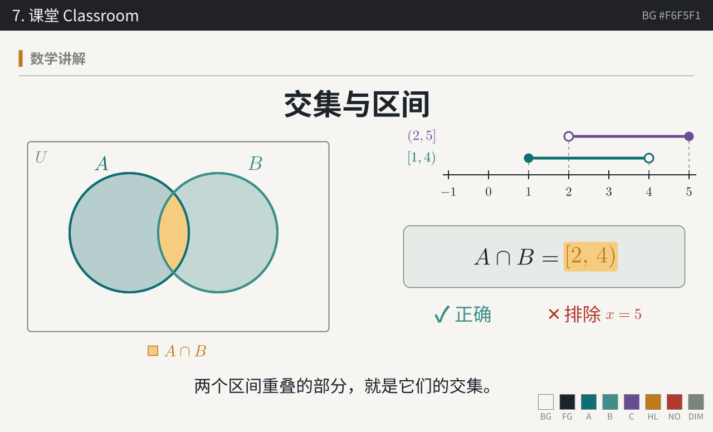

# palette

[中文](#中文) | [English](#english)

## 中文

数学讲解视频的七套配色，为 Manim 设计。每套的颜色角色一致（背景、文字、对象 A/B/C、结论、错误、次要），可以直接互换。


### 草稿纸 Paper

浅色，像彩色铅笔画在草稿纸上，适合题目讲解。

| 角色 | 变量 | 色值 |
|---|---|---|
| 背景 | `BG` |  `#F7F3EA` |
| 主文字 | `FG` |  `#1E2430` |
| 对象 A | `C_A` |  `#2563A8` |
| 对象 B | `C_B` |  `#2F7D5B` |
| 对象 C | `C_C` |  `#C2561F` |
| 结论 / 强调 | `C_HL` |  `#FFD84D` |
| 强调描边（浅底用） | `C_HL_INK` |  `#B7860B` |
| 错误 / 排除 | `C_NO` |  `#C0392B` |
| 次要 / 网格 | `C_DIM` |  `#9AA0A8` |

### 黑板 Chalkboard

深墨绿黑板配粉笔色，课堂感。

| 角色 | 变量 | 色值 |
|---|---|---|
| 背景 | `BG` |  `#1E2B27` |
| 主文字 | `FG` |  `#F1EEE4` |
| 对象 A | `C_A` |  `#F4A6B7` |
| 对象 B | `C_B` |  `#9AD9C8` |
| 对象 C | `C_C` |  `#AFC3F2` |
| 结论 / 强调 | `C_HL` |  `#FFE28A` |
| 错误 / 排除 | `C_NO` |  `#FF8C7A` |
| 次要 / 网格 | `C_DIM` |  `#6F7F79` |

### 玉夜 Jade Night

深青色底，适合代码和技术类内容。

| 角色 | 变量 | 色值 |
|---|---|---|
| 背景 | `BG` |  `#0E1A1C` |
| 主文字 | `FG` |  `#E7F0EC` |
| 对象 A | `C_A` |  `#35C3AE` |
| 对象 B | `C_B` |  `#F2A35E` |
| 对象 C | `C_C` |  `#9C8CFF` |
| 结论 / 强调 | `C_HL` |  `#F6C945` |
| 错误 / 排除 | `C_NO` |  `#EF5B5B` |
| 次要 / 网格 | `C_DIM` |  `#5E6E6D` |

### 宣纸朱砂 Xuan

宣纸配墨线，结论用朱砂印章标出。

| 角色 | 变量 | 色值 |
|---|---|---|
| 背景 | `BG` |  `#F3ECDD` |
| 主文字 | `FG` |  `#22201C` |
| 对象 A | `C_A` |  `#2D4E87` |
| 对象 A 填充 | `C_A_FILL` |  `#3B74C4` |
| 对象 B | `C_B` |  `#4A7C59` |
| 对象 C | `C_C` |  `#B07A2A` |
| 结论 / 强调 | `C_HL` |  `#C8361F` |
| 错误 / 排除 | `C_NO` |  `#5A5550` |
| 次要 / 网格 | `C_DIM` |  `#A79F92` |

### 蓝图 Blueprint

深蓝图纸加细网格和虚线辅助线，适合几何与构造。

| 角色 | 变量 | 色值 |
|---|---|---|
| 背景 | `BG` |  `#0F2A4A` |
| 主文字 | `FG` |  `#EAF2FF` |
| 对象 A | `C_A` |  `#9FD3FF` |
| 对象 B | `C_B` |  `#7FE0C2` |
| 对象 C | `C_C` |  `#FFB4A2` |
| 结论 / 强调 | `C_HL` |  `#FFE066` |
| 错误 / 排除 | `C_NO` |  `#FF6B6B` |
| 次要 / 网格 | `C_DIM` |  `#5B7BA3` |
| 背景网格 | `C_GRID` |  `#2B4C75` |

### 孔版印刷 Riso

荧光粉和孔版蓝叠印出紫色，重叠处本身就是交集。

| 角色 | 变量 | 色值 |
|---|---|---|
| 背景 | `BG` |  `#F4F1EA` |
| 主文字 | `FG` |  `#1B1B3A` |
| 对象 A | `C_A` |  `#FF48B0` |
| 对象 B | `C_B` |  `#0078BF` |
| 对象 C | `C_C` |  `#FFE800` |
| 对象 C 描边（浅底用） | `C_C_INK` |  `#B39A00` |
| 结论 / 强调 | `C_HL` |  `#6C2E8F` |
| 荧光笔底色 | `C_HL_MARK` |  `#FFE800` |
| 错误 / 排除 | `C_NO` |  `#E4572E` |
| 次要 / 网格 | `C_DIM` |  `#A7A3B5` |

### 课堂 Classroom



浅色讲义纸，青绿主色、琥珀强调，第三个对象用葡萄紫，适合大学课程和较长的讲解。

| 角色 | 变量 | 色值 |
|---|---|---|
| 背景 | `BG` |  `#F6F5F1` |
| 主文字 | `FG` |  `#1D232B` |
| 对象 A | `C_A` |  `#0F6E73` |
| 对象 B | `C_B` |  `#3E8E8A` |
| 对象 C | `C_C` |  `#6A4C93` |
| 结论 / 强调 | `C_HL` |  `#C27A1A` |
| 强调描边（浅底用） | `C_HL_INK` |  `#C27A1A` |
| 强调底色（马克笔） | `C_HL_MARK` |  `#F6CD80` |
| 错误 / 排除 | `C_NO` |  `#B03A2E` |
| 次要 / 网格 | `C_DIM` |  `#7D847F` |
| 卡片底色 | `C_CARD` |  `#E7EBE8` |

### 用法（Manim）

```python
from palettes import XUAN as P
config.background_color = P["BG"]
C_A, C_B, C_C = P["C_A"], P["C_B"], P["C_C"]
```

透明度和描边宽度等参数也在 `palettes.py` 里。其他工具可以读 `palette.json`。

### 作者与许可

作者：Boxi Yu（[@BoxiYu](https://github.com/BoxiYu)）

代码和配色数据以 [MIT 许可](LICENSE)发布。使用、修改、再分发时请保留 `LICENSE` 中的版权声明。用这些配色制作的视频不需要署名，欢迎注明出处。

如何引用见 [CITATION.cff](CITATION.cff)。

## English

Seven color palettes for math explainer videos, designed for Manim. Every palette uses the same color roles (background, text, objects A/B/C, conclusion, error, secondary), so they can be swapped directly.


### Paper (草稿纸)

Light, like colored pencil on scratch paper; suited to worked problems.

| Role | Variable | Value |
|---|---|---|
| Background | `BG` |  `#F7F3EA` |
| Main text | `FG` |  `#1E2430` |
| Object A | `C_A` |  `#2563A8` |
| Object B | `C_B` |  `#2F7D5B` |
| Object C | `C_C` |  `#C2561F` |
| Conclusion / emphasis | `C_HL` |  `#FFD84D` |
| Emphasis stroke (on light backgrounds) | `C_HL_INK` |  `#B7860B` |
| Error / excluded | `C_NO` |  `#C0392B` |
| Secondary / grid | `C_DIM` |  `#9AA0A8` |

### Chalkboard (黑板)

Chalk colors on a dark green-black board; a classroom feel.

| Role | Variable | Value |
|---|---|---|
| Background | `BG` |  `#1E2B27` |
| Main text | `FG` |  `#F1EEE4` |
| Object A | `C_A` |  `#F4A6B7` |
| Object B | `C_B` |  `#9AD9C8` |
| Object C | `C_C` |  `#AFC3F2` |
| Conclusion / emphasis | `C_HL` |  `#FFE28A` |
| Error / excluded | `C_NO` |  `#FF8C7A` |
| Secondary / grid | `C_DIM` |  `#6F7F79` |

### Jade Night (玉夜)

Dark teal background; suited to code and technical content.

| Role | Variable | Value |
|---|---|---|
| Background | `BG` |  `#0E1A1C` |
| Main text | `FG` |  `#E7F0EC` |
| Object A | `C_A` |  `#35C3AE` |
| Object B | `C_B` |  `#F2A35E` |
| Object C | `C_C` |  `#9C8CFF` |
| Conclusion / emphasis | `C_HL` |  `#F6C945` |
| Error / excluded | `C_NO` |  `#EF5B5B` |
| Secondary / grid | `C_DIM` |  `#5E6E6D` |

### Xuan (宣纸朱砂)

Ink lines on xuan paper, with conclusions marked by a cinnabar seal.

| Role | Variable | Value |
|---|---|---|
| Background | `BG` |  `#F3ECDD` |
| Main text | `FG` |  `#22201C` |
| Object A | `C_A` |  `#2D4E87` |
| Object A fill | `C_A_FILL` |  `#3B74C4` |
| Object B | `C_B` |  `#4A7C59` |
| Object C | `C_C` |  `#B07A2A` |
| Conclusion / emphasis | `C_HL` |  `#C8361F` |
| Error / excluded | `C_NO` |  `#5A5550` |
| Secondary / grid | `C_DIM` |  `#A79F92` |

### Blueprint (蓝图)

Dark blueprint paper with a fine grid and dashed guide lines; suited to geometry and constructions.

| Role | Variable | Value |
|---|---|---|
| Background | `BG` |  `#0F2A4A` |
| Main text | `FG` |  `#EAF2FF` |
| Object A | `C_A` |  `#9FD3FF` |
| Object B | `C_B` |  `#7FE0C2` |
| Object C | `C_C` |  `#FFB4A2` |
| Conclusion / emphasis | `C_HL` |  `#FFE066` |
| Error / excluded | `C_NO` |  `#FF6B6B` |
| Secondary / grid | `C_DIM` |  `#5B7BA3` |
| Background grid | `C_GRID` |  `#2B4C75` |

### Riso (孔版印刷)

Fluorescent pink and riso blue overprint to purple, so the overlap is itself the intersection.

| Role | Variable | Value |
|---|---|---|
| Background | `BG` |  `#F4F1EA` |
| Main text | `FG` |  `#1B1B3A` |
| Object A | `C_A` |  `#FF48B0` |
| Object B | `C_B` |  `#0078BF` |
| Object C | `C_C` |  `#FFE800` |
| Object C stroke (on light backgrounds) | `C_C_INK` |  `#B39A00` |
| Conclusion / emphasis | `C_HL` |  `#6C2E8F` |
| Highlighter background | `C_HL_MARK` |  `#FFE800` |
| Error / excluded | `C_NO` |  `#E4572E` |
| Secondary / grid | `C_DIM` |  `#A7A3B5` |

### Classroom (课堂)


Light handout paper with teal for structure, amber for emphasis and plum for the third object; suited to university courses and longer lectures.

| Role | Variable | Value |
|---|---|---|
| Background | `BG` |  `#F6F5F1` |
| Main text | `FG` |  `#1D232B` |
| Object A | `C_A` |  `#0F6E73` |
| Object B | `C_B` |  `#3E8E8A` |
| Object C | `C_C` |  `#6A4C93` |
| Conclusion / emphasis | `C_HL` |  `#C27A1A` |
| Emphasis stroke (on light backgrounds) | `C_HL_INK` |  `#C27A1A` |
| Emphasis wash (marker) | `C_HL_MARK` |  `#F6CD80` |
| Error / excluded | `C_NO` |  `#B03A2E` |
| Secondary / grid | `C_DIM` |  `#7D847F` |
| Card background | `C_CARD` |  `#E7EBE8` |

### Usage (Manim)

```python
from palettes import XUAN as P
config.background_color = P["BG"]
C_A, C_B, C_C = P["C_A"], P["C_B"], P["C_C"]
```

Opacity, stroke width and other parameters are also in `palettes.py`. Other tools can read `palette.json`.

### Author and license

Author: Boxi Yu ([@BoxiYu](https://github.com/BoxiYu))

The code and color data are released under the [MIT License](LICENSE). When using, modifying, or redistributing them, please keep the copyright notice in `LICENSE`. Videos made with these palettes do not require attribution, but crediting the source is welcome.

For how to cite, see [CITATION.cff](CITATION.cff).
